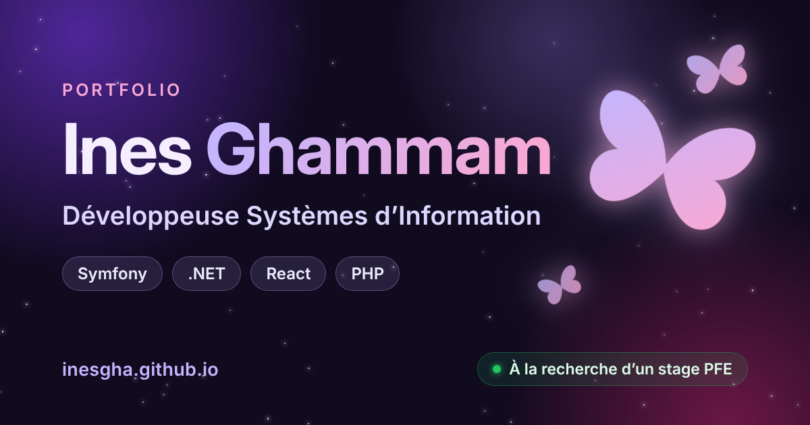

# Portfolio — Ines Ghammam



Mon site personnel : présentation, compétences, projets, parcours et contact.

**Voir le site en ligne : [inesgha.github.io](https://inesgha.github.io)**

## Fonctionnalités

- Mode clair / sombre, mémorisé d'une visite à l'autre
- Papillons animés en JavaScript, qui s'écartent de la souris (un clic sur une zone vide en fait apparaître un nouveau)
- Animations d'apparition au défilement et compteurs animés
- Titre qui s'écrit tout seul dans la section d'accueil
- Design responsive : ordinateur, tablette et mobile
- CV à télécharger en français et en anglais
- Formulaire de contact qui prépare l'e-mail dans la messagerie du visiteur
- Aperçu soigné du lien sur LinkedIn et WhatsApp (balises Open Graph)
- Référencement : plan du site, `robots.txt` et données structurées pour Google
- Page 404 personnalisée
- Accessibilité : navigation au clavier, textes alternatifs, respect du réglage « réduire les animations »

## Technologies

- **HTML5** sémantique
- **CSS3** : variables pour les thèmes, Grid, Flexbox, animations
- **JavaScript** sans framework : `IntersectionObserver`, `requestAnimationFrame`, `localStorage`
- Hébergement : **GitHub Pages**

## Structure du projet

```text
.
├── index.html            # contenu du site
├── 404.html              # page « introuvable »
├── css/
│   └── style.css         # design, couleurs et mode sombre
├── js/
│   ├── main.js           # thème, menu, animations, formulaire
│   └── butterflies.js    # papillons animés
├── assets/               # CV, icônes et image d'aperçu
├── robots.txt
└── sitemap.xml
```

## Lancer le projet en local

1. Cloner le dépôt : `git clone https://github.com/inesgha/inesgha.github.io.git`
2. Ouvrir le dossier dans VS Code
3. Clic droit sur `index.html` › **Open with Live Server**

## Autrice

**Ines Ghammam** — [LinkedIn](https://www.linkedin.com/in/ines-ghammam-2a6794350) · [GitHub](https://github.com/inesgha) · [E-mail](mailto:ines.ghammam.2005@gmail.com)
